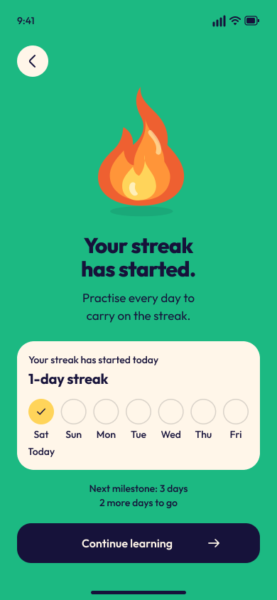
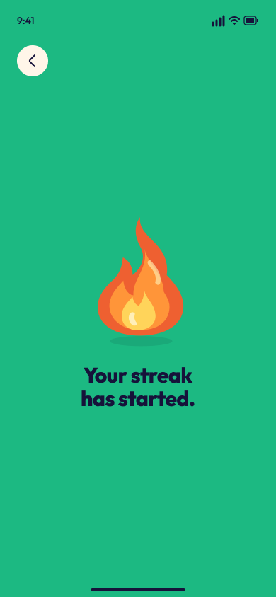

# Luvani streak celebration design

[Editable Figma design](https://www.figma.com/design/N2oYPd6Ol0I4XgmD0LUpk8?node-id=2-25)

Two 390 × 844 frames show the central entrance composition and the settled one-day streak page. The original five-layer flame matches `apps/mobile/assets/rive/source/streak/resting.svg`. The darker celebration green is `#1CB982`; navy and cream use the app’s `#16123A` and `#FFF6E9`. All text uses Outfit with the existing product type scale. Text, vectors, auto-layout containers, palette aliases, and reusable control/day components remain editable.

The seven-day calendar is an explicit design fixture: Saturday 10 October 2026 through Friday 16 October 2026. Production labels, streak count, completion, copy, and milestone must come from authoritative qualifying activity data. The completed date has a checkmark and Today label; future dates remain outlined.

The screenshots were visually inspected. The Figma wrapper contains 59 semantic descendants, including 16 text nodes, 14 vectors, and 10 component instances, with no raster screenshot or image fills. Font validation confirms Outfit. Runtime animation, navigation, lifecycle, accessibility, and data behaviour are implemented and verified separately in the app.

