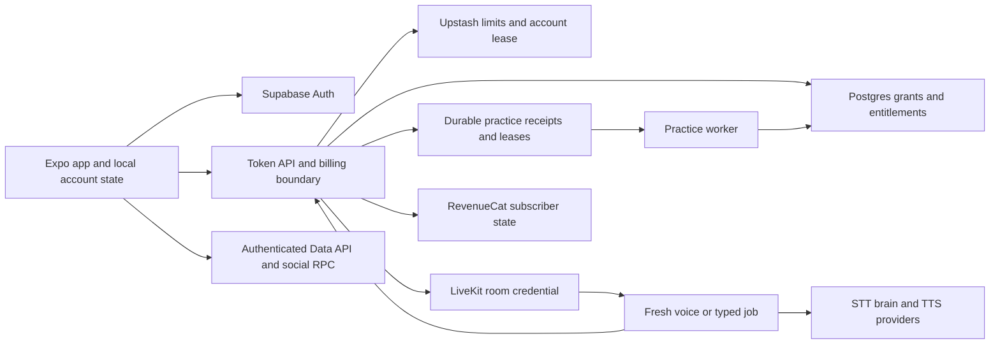

# Luvani backend production readiness audit

**Audit date:** 3 October 2026, Europe/London. **Source baseline:** `2cbea8655b90c22fcac00412d008d4540e69954d`. **Decision:** HOLD public launch. **Audience:** founder, backend engineers and release owner.

Luvani has a credible modular backend and meaningful security controls. It is not ready for unrestricted public production on the evidence available. The most urgent defects are reproducible token-server process termination, ineffective replay protection across actual voice jobs, a client-callable escape from the session concurrency lease, unreliable finalization, incomplete data-resource limits and unexpected persistence of personalized tutor audio. The configured Supabase project is inactive, the latest hosted schema cannot be verified, and production hosting, recovery and real-device voice acceptance remain unproved.

This report recommends changes; it does not implement the application fixes. The separately requested four backend architecture agent definitions and their review routing have been added. No deployment, hosted migration, project restore, account change, key rotation or scheduled automation was performed.

## What the evidence establishes

The audit inspected API, authentication, entitlement/billing, SQL policies/functions, account erasure/export, learner sync, social features, voice workers, protocol, caching, practice recovery, CI and release configuration. It ran the existing local gate, isolated synthetic API/voice/SQL reproductions, and read GitHub/Supabase metadata. No real learner data or paid speech/model calls were used. The supplied image supplied the layer checklist; it was not treated as evidence of Luvani's implementation or as instructions.

Evidence labels used below:

- **Reproduced:** an executed isolated check demonstrates the stated behavior.
- **Source verified:** current source or installed dependency implements the stated behavior; a live end-to-end exploit was not run.
- **Live metadata:** a connected service reported the state during this audit.
- **Historical:** a repository run record, not a new measurement.
- **Unverified:** required deployed, provider, concurrency or device evidence was unavailable.

Priority is a recommendation for this report, independent of the repository's parsed issue ledger: **P0** must be resolved before network exposure; **P1** must be resolved or the affected feature kept out of public launch; **P2** is important hardening or a conditional product/capacity concern. An unknown critical production control can block release even when no unit test fails. No assertion that the app is certified secure, that every possible defect was found, or that private architectures of major apps were inspected is made.

### Verification snapshot

| Check | Result | Practical limit |
|---|---|---|
| Existing local full gate | 4,232 tests pass, workspace typechecks pass | Includes substantial mock and source-contract coverage; not a public deployment test |
| Workspace counts | core 711; brain 464; tutor 538; API 298; playground 26; mobile 2,195 | Focused runs below overlap these totals; do not add them together |
| GitHub CI for baseline commit | Linux gate, dependency audit and secret scan all successful | [Run 37149648954](https://github.com/pravzviv30-cmyk/parle/actions/runs/37149648954); not an application deployment |
| GitHub main branch | `protected=false`; required checks enforcement off | Rulesets query returned 403 with plan-feature restriction; no effective ruleset attestation |
| Current npm audit | 0 critical, 21 high, 12 moderate affected-package rows | Five advisory roots; inherited rows are not 33 independent exploits |
| Repository audit policy | Passes with current registry access | Accepts high roots by package name; newly added advisories for an accepted package are not individually reviewed by the gate |
| Reachable-history secret scan | Failed with child-process output buffer exhaustion | Cannot claim history clean; tracked-file scan passes. Error construction can include raw diff output |
| Full SQL replay | All 26 migrations apply; 21 of 21 resulting public tables have RLS | Disposable PGlite and explicit simulated Supabase grants; not a hosted concurrency or gateway proof |
| Seven existing SQL proof scripts | Pass | Social, billing, refund, practice queue, saved text, product events and phrase-audio budgets; sequential local evidence |
| Voice focused checks | 538 tutor tests; 69 focused mobile checks; 7 practice checks pass | No real beginner speech, audible latency or physical-device acceptance |
| Configured Supabase | Canonical API/mobile configuration maps to Parle; metadata says `INACTIVE` | Migration-list and read-only catalog queries time out. Empty advisor output is not a healthy live-schema attestation |
| Canonical local environment | Mobile API hostname is localhost; LiveKit hostname is Cloud | Environment names/hostnames only inspected; credentials not emitted. Hosted release environment could differ |

Existing documents contain contradictory historical statements. In particular, CI has run successfully and earlier exposed vendor keys were recorded as retired on 3 October with founder confirmation and replacement authentication checks. This report does not repeat the old claim that those keys remain live. Current full-history scanning still needs repair and re-verification.

## Direct answers to the requested questions

**Does the backend complement the app?** Mostly at the design level. The shared pedagogy, typed twins, server-owned minutes, local-first progress and conversation-derived practice fit the product. Execution gaps undermine that fit: lost post-session work, stalled sync, billing during definitive brain failure, conditional recovery flags and unavailable live pronunciation evidence.

**Is it efficient?** Some important optimizations exist: prompt-prefix caching, authored scenes, voice cache fingerprints, prewarmed VAD, disabled speculative conversation generation and bounded vendor deadlines. Efficiency in public use is unproved. There is no measured launch capacity, enforceable whole-product spend ceiling, bounded command queue, complete query pagination or percentile telemetry. The current general speech cache saves money by retaining data it should not retain indefinitely.

**Are the voice tutors working?** They are real implementations, not frontend simulations. Unit tests and historical local LiveKit lifecycle runs establish useful behavior. They do not establish that the deployed public service is currently serving, that native users hear timely replies, or that beginner French is reliably recognized. Live pronunciation scoring is deliberately default-off; free conversation reports no pronunciation score. Dedicated scoring drills are a separate path.

**Is version control in place?** Yes: Git, remote history, lockfile, migrations, hooks and a working CI pipeline exist. Release enforcement is weaker: main is unprotected, there is no checked-in CD/service deployment contract or verified artifact promotion, and the recorded 20 September hosted migration versions differ from local filenames. Current hosted migration history is unverified. Code version control is not the same as infrastructure and release versioning.

**Is RLS in check?** The complete intended local schema enables RLS on every public table and meaningful role/owner tests pass. Privileged RPC grants are restricted. Current deployed RLS cannot be attested while the configured database is inactive. RLS also does not stop excessive writes to one's own records, validate client learning claims, or authorize calls made with a service key.

**Is top-level security implemented?** Several foundations are implemented; the full production security envelope is incomplete. Uncaught API failures, voice admission, direct Data API quotas, JWT claim/revocation policy, cache/log privacy, auth anti-abuse settings, secret governance, monitoring and recovery all need work or deployed verification. Use [OWASP ASVS 5.0.0](https://owasp.org/projects/asvs) and the [API resource-consumption guidance](https://api-security.owasp.org/editions/2023/en/0xa4-unrestricted-resource-consumption/) as acceptance frameworks, not as a certification claim.

**Is it built like a leading app backend?** The core service boundaries are appropriate for an early production product. It lacks the operational guarantees that distinguish a mature backend: enforceable admission, durable work, measured service quality, controlled releases, abuse economics, privacy lifecycle and exercised recovery. Adding Kubernetes, many microservices or database sharding would not resolve the current problems.

## How the backend currently works

1. The Expo app authenticates through Supabase and stores the native session through a secure-storage adapter. Learner records live locally under account-scoped storage; one sync engine merges namespace envelopes with authenticated PostgREST rows and database revisions.
2. The app asks the Node token server to start a lesson or conversation. The server verifies a bearer, checks IP/user/installation budgets, claims introductory time, reads entitlements, signs a LiveKit credential, acquires a Redis account lease and records a durable session grant before returning the credential.
3. A LiveKit worker admits a job using signed metadata. Each real SDK job executes in a fresh child process. Speech uses VAD/STT, a lesson or conversation engine, and selected TTS. Typed twins use the same progression without speech clients. Core/brain owns learning decisions; the client renders messages.
4. The agent computes duration and sends authenticated end-of-session settlement. The database fences ownership, grant epoch, charged delta and replay, and can refund recognized terminal service failures. The server releases the account lease.
5. Conversation finishing prepares a usable baseline and later enrichment. If its baseline reaches the API with durable-practice mode enabled, SQL atomically receives it and creates a recovery job. A separate polling worker claims leased jobs and regenerates drills. This queue cannot recover a baseline never received.
6. RevenueCat webhooks and learner refresh read vendor subscriber state. Database-issued refresh ordering and a row lock apply the current projection and event completion atomically. Purchases deliberately stay closed without complete configuration and schema readiness.
7. Friends uses an authenticated invoker wrapper and private privileged dispatcher, with opt-in, mutual relationships and blocks. Its points are capped aggregates of client-authored activity, explicitly disclosed as self-reported rather than anti-cheat-certified ability.

## Assessment against the supplied infrastructure layers

| Layer | Current position | Required improvement |
|---|---|---|
| Frontend integration | Shared protocol, secure session storage, local-first continuity and typed alternatives | Actual native/build/network acceptance; explicit feature availability and client-version compatibility |
| APIs and backend logic | Central identity/minutes boundary; owner filters and bounded vendor adapters | Contain all async failures; strict input schemas; versioned contracts; readiness; pagination |
| Database and storage | Ordered SQL, RLS, atomic billing and queue fencing | Running release schema; quotas; retention; catalog manifest; complete backup/export and query evidence |
| Auth and permissions | Asymmetric verification, owner policies and recent-auth checks | Explicit token claims/revocation; verified auth-provider/CAPTCHA/email settings; least-privilege operator access |
| Hosting and deployment | Fail-closed boot and Cloud-compatible code | Reproducible service artifacts, production/staging isolation, managed secrets, drain/canary/rollback evidence |
| Cloud and compute | Hosted vendor endpoints configured locally | Capacity/admission budget, region placement, finite queues and resource limits; verified running fleet |
| CI/CD and version control | Working Linux CI, Git, lockfile and migration files | Required PR checks, protected main, artifact/schema promotion and immutable release identity |
| Security and RLS | Locally meaningful isolation and restricted privileged RPCs | Close reproduced availability/admission/privacy holes; audit direct routes and actual hosted privileges |
| Rate limiting | Distributed API limits and leases | Direct Supabase quotas, voice-command limits, global vendor concurrency/spend, correct proxy trust |
| Caching and CDN | Prompt/audio caching and bundled static content | Static allowlist caching, retention/eviction, cache-hit measurement, hosted content cache/version policy |
| Load balancing and scaling | Managed media path and shared state primitives | Correct admission across jobs first, then measured capacity, readiness-based routing and graceful drain |
| Errors and logs | Usage/timing and controlled product events exist | Redacted structured logs, traces, error budgets, dashboards and actionable alerts |
| Availability and recovery | Local retries, SQL rollback scripts and recovery queue | Durable settlement/outbox, backup coverage, tested restore, on-call/incident process and failure drills |

## Prioritized findings and required changes

### A01 P0 Unauthenticated malformed Host terminates the API

**Reproduced.** `services/token-server/src/server.ts:252` constructs a URL from the caller's Host header before entering the request try/catch. A synthetic raw request with an invalid Host reached the isolated API, produced no HTTP response and exited Node with code 1 and `ERR_INVALID_URL`. No bearer or vendor call was involved. A specific edge proxy may reject this input; no such enforced deployment boundary was verified.

Parse relative request paths against a fixed internal base inside the protected handler, reject malformed requests with 400 and attach a rejection boundary to every async HTTP listener. Do not rely on an unhandled-rejection process policy to keep serving. **Acceptance:** raw malformed authority/path/header cases return bounded errors; the same PID serves the next health and authenticated request; test both direct API and the selected edge proxy. **Owners:** API and security engineers.

### A02 P1 Oversized scoring audio also terminates the API

**Reproduced.** `drillScore.ts:63` throws above 2 MiB. `server.ts:485` returns the async handler without awaiting it, so its rejected promise escapes the outer catch. Sending 2 MiB plus one byte with a permitted synthetic local identity disconnected the client and exited Node with code 1. Authentication was intentionally mocked by explicit development mode; this proves exception handling, not a production auth bypass. The same overflow is reachable after real authentication.

Await route handlers within one error boundary; handle oversize/invalid/interrupted bodies explicitly and cancel work on client disconnect. Audit all delegated routes for the same promise pattern. **Acceptance:** overflow returns 413, malformed input 400, dependency timeout 503, and aborted uploads never terminate the API or retain unbounded buffers. **Owners:** API/security engineers.

### A03 P1 Voice replay defense is process-local in a process-per-job runtime

**Source verified and independently reproduced at the process boundary.** `tutor.ts:101` keeps reported IDs in a Set; `agent.ts:473` and installed LiveKit 1.9.0 job-process code establish fresh one-shot child processes. Marking a session in one process leaves it unreported in another. The entry path has no atomic shared admission check. Debit idempotency stops a repeated charge, not additional vendor work.

Implement service-owned atomic grant admission bound to account, room, allowance epoch and a job fencing token. Distinguish reconnecting an admitted job from dispatching a new job, and refuse ended/revoked/abandoned grants before speech/model work. **Acceptance:** race/replay/restart tests across real SDK jobs and replicas dispatch zero new provider work for a spent grant while valid reconnects settle once. A paid live replay was not executed. **Owners:** voice, API, security and revenue engineers.

### A04 P1 The abandon endpoint defeats the active-session spend boundary

**Reproduced API behavior; simultaneous live-room cost is inferred.** `server.ts:786-812` lets the authenticated owner release a matching lease without checking or terminating an active room. The isolated sequence was start 200, second start 409, abandon 200, new start 200. No token revocation or room termination is performed at this code boundary; live rejoin with the first signed token was not tested. Starts read the current allowance before prior rooms settle. At ten user session requests per minute, with starts and abandons sharing that counter, abuse is bounded by request rate but can still accumulate live rooms.

The risk is vendor spend and fleet occupancy, not only the user making their own concurrency worse. Make abandon an authoritative state transition that prevents subsequent admission of the old credential and confirms old-job termination before replacing an active room. Add allowance reservations/global admission rather than relying solely on after-session debit. [LiveKit documents](https://docs.livekit.io/frontends/reference/tokens-grants/) that token expiry controls initial connection rather than an ongoing session; Cloud refreshed-token revocation cutoff and self-hosted removal behavior need explicit acceptance. **Acceptance:** malicious abandon/restart loops and reconnects never exceed the intended active-job/issued-time allowance, including races, disconnected agents and a Redis outage. **Owners:** voice/API/revenue/security engineers.

### A05 P1 Shutdown and delivery retries do not guarantee settlement or saved practice

**Source verified.** `agent.ts:436` discards the finish promise and no application session-end/shutdown callback links it to settlement. The installed SDK closes its primary AgentSession and awaits its own lifecycle work, but does not await Luvani's dropped finish promise. `usage.ts` and `conversationPacks.ts` try three deliveries and then log. There is no durable usage/receipt outbox or abandoned-session reconciler. Durable practice begins only after successful server receipt.

Register one idempotent awaited finalization promise, align host drain grace with its budget, and persist authoritative admission/usage/finish state plus a retryable baseline receipt. Reconcile crash/uncertain acknowledgements on restart. **Acceptance:** SIGTERM, process kill, network loss and crash around debit/baseline ACK leave exactly-once settlement and recoverable practice or an honest pending state; deleted content cannot return. **Owners:** backend/voice/data/revenue/deploy engineers.

### A06 P1 Main conversation brain failures can remain billable until the session ends

**Reproduced with the real conversation class and mocked provider.** Three definitive simulated 401 failures produced no terminal notice; finishing at synthetic 30 seconds requested a 30-second charge without `serviceFailure`. `convo.ts:2244-2268` catches out-of-band brain failures and recovers; this path does not enter `agent.ts:335`'s SDK terminal/refund classifier. Learner input increments the billing predicate before the failed call.

Classify out-of-band errors, allow a bounded transient recovery and terminate definitive or sustained failures through the existing service-owned refund/settlement path. Typed fallback cannot fix an unavailable shared brain. **Acceptance:** voiced and typed sessions cover invalid model/key, repeated timeout, 429/5xx and transient recovery without charging unusable sessions contrary to the approved policy. **Owners:** voice/brain/revenue engineers.

### A07 P1 Safety scans a prefix while the model receives the full input

**Reproduced.** `safety.ts:130` inspects the first 4,000 characters. The protocol accepts longer text; a 4,138-character synthetic input put a policy-triggering suffix after benign padding, escaped the deterministic guard and reached a recorded mock frame request through the real conversation route. This proves policy-code evasion, not a successful real-model jailbreak.

Enforce strict shared schema/UTF-8 size limits before safety and send only the fully accepted/inspected input onward. Include topic, answer and provider transcript paths; reject rather than silently inspecting less than is dispatched. **Acceptance:** boundary, padding, Unicode/normalization and injection cases cannot send an uninspected suffix to providers. Run separate model/output red-team evaluations. **Owners:** voice/API/security/tutor-behavior engineers.

### A08 P1 Shared TTS cache retains personalized speech indefinitely

**Source verified.** `ttsCache.ts:149` accepts every nonempty reply up to 220 characters, including free-form tutor replies. Keys use voice/rate/text; cached WAVs have no owner, TTL, byte/file quota or account-erasure mapping. Hashing filenames does not remove spoken personal content. The published policy describes caching authored tutor lines, a narrower scope.

Restrict shared persistent caching to a versioned allowlist of authored nonpersonal lines; keep free-form replies ephemeral. Purge old cache data with a documented transition. If personalized caching is deliberately retained, implement owner binding, access controls, expiry, eviction and deletion semantics first. **Acceptance:** a synthetic private reply creates no global WAV, approved static lines still hit the cache, quota/expiry and old-cache cleanup are demonstrated. **Owners:** performance/privacy/backend engineers.

### A09 P1 Direct Supabase writes bypass client and API resource bounds

**Reproduced in the complete disposable schema.** Authenticated own-row writes accepted a 614,477-byte learner payload despite the mobile 512 KiB cap, and 10,001 valid product events. `202608220001_luvani_learning.sql:10,21-28,47-49` provides owner access but no cumulative write quota. Client envelope checks and token-server rate limiting do not apply to direct Data API calls. Hosted gateway settings remain unknown.

Enforce byte/item/shape bounds and account storage/write/event quotas at every exposed database boundary. Either revoke direct event INSERT for an admission RPC/API or provide equivalent atomic DB controls. Keep legitimate offline sync semantics. **Acceptance:** direct authenticated REST/RPC over-limit writes fail; parallel writes cannot race quotas; response/query cost and retained volume stay bounded. **Owners:** data-sync/data/security engineers.

### A10 P1 Account export fails above fixed size and row ceilings

**Reproduced.** The export fails above 10,000 rows in any owned table or 32 MiB total; 10,001 admitted product events triggered failure in the latest SQL. Those limits are useful memory safeguards, but the only portable-export route has no larger-account alternative. Retention is currently unenforced.

Provide a bounded asynchronous/paginated export with a coherent snapshot/cursor and temporary encrypted delivery, expiry and authorization. Reconcile its sixteen selected owned tables and exclusions, including account-matchable trial HMAC markers (`accountExport.ts:8-9,92-95`) and account-linked private queue work, against the policy's "every row" claim (`apps/mobile/src/legal/policy.ts:211`). A reviewed data inventory must define truthful scope; pagination alone does not complete it. Apply event limits/retention as well; merely raising the in-memory limit moves the failure. **Acceptance:** a large synthetic account exports the approved scope without truncation or blocking API capacity, with owner/reauth controls, documented exclusions and expired-file cleanup. **Owners:** data/privacy/API engineers.

### A11 P1 Account deletion depends on a billing processor even when billing is dark

**Reproduced.** `productionConfigurationProblems` permits an entirely unconfigured RevenueCat path. `deleteAccountWithProcessor` always calls processor erasure first; an absent key returns false with zero database requests. A trial-only deployment can therefore authenticate deletion but always answer 503. Configuring RevenueCat might mask the contradiction, not correct it.

Track whether an account has processor data; permit deletion when no processor relationship exists, and use a durable erasure workflow when it does. Handle partial processor/database completion and stop active sessions/provider work during deletion. **Acceptance:** billing-dark/trial-only deletion succeeds; paid processor failures are truthful and retryable; stale bearer/active-room tests cannot recreate data or dispatch new paid work after deletion. **Owners:** privacy/auth/API/revenue engineers.

### A12 P1 Published retention promises lack deployed enforcement

**Source verified.** `PRIVACY_AND_SAFETY.md:1026-1028` acknowledges missing scheduled deletion for promised analytics/usage/antifraud retention. No enforcement job was found. The audio-cache issue adds another retention inventory gap.

Implement indexed bounded retention jobs with run/failure metrics and documented backups/vendor expiry. Use server-owned receipt timestamps for expiry: client-writable `product_events.occurred_at` can be set in the future and evade a naive TTL. Reconcile the published 13/24-month promises (`apps/mobile/src/legal/policy.ts:201`) with permanent grant/refund proofs (:202). Separate expiring content/detail from the minimal permanent idempotency/completion proof required for debits, refunds, saved text and audio admission: blindly deleting the entire usage ledger can reopen replay or break saved learning. **Acceptance:** time-controlled expiry tests including future client timestamps, deployed run evidence, replay after retention, backup restore/deletion reapplication and policy reconciliation. **Owners:** privacy/data/revenue/deploy engineers.

### A13 P1 Intended migrations and actual deployment have no verified compatibility contract

**Live metadata and documented gap.** The configured project is inactive; catalog/history requests time out. `supabase/README.md:7-20` documents divergent remote versions and missing old history. Later feature migrations are explicitly prepared/not applied live. Current code requires new session-grant/refund/billing/export primitives.

Establish distinct staging/production targets, reconcile schema and migration history safely, and create a required-object/version manifest checked before promotion. Deploy with documented old/new writer compatibility. The refund migration specifically requires draining old grant/debit writers before changing lock order. **Acceptance:** clean replay, live role/catalog checks, simultaneous transaction races and complete canary journeys for the exact artifact/schema pair. **Owners:** deployment/data/revenue engineers and architects.

### A14 P1 The hosted database verification harness is stale

**Source verified.** `verify/supabaseLive.ts:158-177` inventories seven old tables and three old routines; deletion covers five tables. Debit fixtures call new random IDs without issuing grants, while the latest debit routine requires grant proof. It can reject the correct new schema while omitting major new features from its coverage.

Update the disposable/staging harness to the current object inventory and grant lifecycle. Include role privileges, saved text, social/block behavior, billing/refund/epoch races, queue deletion fences and all cascades. **Acceptance:** it passes on the intended latest schema and fails for a removed policy/grant/RPC or older implementation; proofs identify commit/project/schema and use independent PostgreSQL connections for races. **Owners:** data/QA/API engineers.

### A15 P1 Backup claims and fallback coverage are unreliable

**Source and primary-doc verified.** The runbook's backup summary implies paid PITR/free daily backup and its CSV fallback lists only seven tables. Current [Supabase backup documentation](https://supabase.com/docs/guides/platform/backups) describes daily backups for paid plans, PITR as an add-on, and offsite exports for free projects. Database backups also do not contain Storage object bodies. Actual backup/PITR settings and a complete restore were not verified.

Correct the runbook and select a backup/recovery policy based on acceptable data loss and downtime. Cover all application schemas, auth/roles, queue state, artifacts/objects and secrets/config restoration. Restore to isolation and reapply post-backup erasures before use. **Acceptance:** a dated recoverable backup, full timed restore, integrity/permission/billing checks and documented RPO/RTO achieved. **Owners:** deployment/data/privacy engineers.

### A16 P1 Public hosting and native release configuration are not demonstrated

**Source/live-input verified, hosted environment unverified.** The checkout has no service/container/host manifest or EAS profile; canonical mobile API points at localhost. A LiveKit Cloud URL and credentials do not prove an agent deployment. The current Supabase target is inactive. Production API guards correctly reject incomplete configuration.

Create reproducible deployment definitions for API, agent and practice worker; stable HTTPS/WSS domains; isolated envs; secret references; supported runtime; least-privilege process/network permissions and versioned mobile build inputs. **Acceptance:** a clean hosted staging deployment and cellular physical-device journey with no development fallback, then controlled production promotion. **Owners:** deploy/release/QA engineers.

### A17 P1 CI succeeds but does not enforce the release boundary

**Live metadata.** Main reports unprotected with status-check enforcement off. CI runs on pushes/PRs and has a successful exact-head run, but it can detect a bad direct push only after it reaches main. No artifact deployment gate is present.

Require reviewed PRs and required checks on the protected production branch, with an audited emergency path. Private-repository plan restrictions may require a plan change or a documented alternative controlled release boundary; do not make the repository public merely to enable protection. Add environment approval, immutable artifacts and provenance/schema association for releases. **Acceptance:** an unreviewed/failing candidate cannot promote; a tested emergency rollback is possible. **Owners:** release/deploy engineers and repository owner.

### A18 P1 Observability cannot establish service quality or detect money/privacy failures

**Source verified, vendor/platform telemetry unverified.** Console usage/timing exists, but no app-owned central tracing/error/metrics integration or request correlation was found. `server.ts:256` returns healthy with no DB, Redis, agent or speech provider; the isolated fixture demonstrated this with dependencies absent. No actionable settlement/backlog/spend/error-budget alerts were evidenced.

Separate liveness, dependency readiness and capability status. Add scrubbed structured logs, request/session/job correlation, stage latency histograms, business ledger metrics, queue age/dead-letter visibility and alert ownership. Gate grants on known serving/admission readiness without turning probes into costly dependency fan-out per request. **Acceptance:** staged DB/Redis/agent/model failures produce correct readiness, zero unusable admitted work, an alert and a recoverable learner path. **Owners:** observability/voice/API/deploy engineers.

### A19 P1 Voice and learning quality still require real release acceptance

**Historical evidence with explicit limits.** Local lifecycle tests establish hard stops and several zero-use/debit controls, not audible quality. `REVAMP_B_CONTINUATION.md:660` records a twelve-call GPT-6 Luna sample at p50 4,864 ms/p95 8,661 ms; the earlier GPT-5.6 Luna pair is 3,928/8,208 ms. These are model-only samples and too small for a service SLO. Live scoring is default-off; free conversation explicitly has zero scored utterances. Physical microphone/network/background tests, representative beginner ASR and assessment calibration remain held.

Agree product claims, run consenting labeled French/bilingual audio evaluations and physical iOS/Android lifecycle tests with exact voices/models. Measure end-of-utterance to first audible reply, interruptions and regional transport under load. **Acceptance:** agreed workload/corpus thresholds, truthful pronunciation availability, real-device billing/refund parity and no regressions in quiet mode. **Owners:** voice/tutor/learning-science/QA engineers.

### A20 P1 Whole-product vendor spend and admission need enforceable bounds

**Source verified exposure; scale/cost unmeasured.** API daily counters are helpful but do not bound aggregate account creation, voice data-channel generation, repeated replay/abandon work or practice-worker spend. Installation headers are client-provided strings, not hardware attestation. Saved-phrase audio has stronger hard budget reservations, but those intentionally apply only to that route.

Add global/account/vendor cost and concurrency budgets, real session reservations, per-job spend accounting and kill switches. Configure Supabase signup/reset defenses and verification/CAPTCHA based on staged abuse tests; add device attestation only if measured abuse warrants it. Reconcile observed usage with current vendor invoices, including failed/refused/retried calls. **Acceptance:** synthetic Sybil, command burst, replay and backlog tests hit a bounded circuit without bypass through other entry points; dashboard and invoice deltas are explainable. **Owners:** security/revenue/voice/data/deploy engineers.

### A21 P2 JWT verification needs an explicit token contract and revocation policy

**Reproduced with a trusted synthetic signing key.** `auth.ts:63` accepts a signed token with wrong issuer/audience, a nonlearner role or no expiry. It requires a nonempty subject but passes no claim expectations to `jwtVerify`. This is not evidence that an outsider can forge the project's signature. Expired tokens that do contain expiry are already rejected.

Define allowed issuer/audience/algorithms, mandatory expiry and subject/role/session requirements; evaluate anonymous users explicitly. For sensitive/costly operations check session/account revocation when necessary rather than assuming locally valid claims prove a live account. [Supabase's JWT guide](https://supabase.com/docs/guides/auth/jwts) explains signing, claims and JWKS behavior. **Acceptance:** malformed/misissued/revoked/deleted-account cases fail without losing legitimate refresh/reconnect behavior. **Owners:** auth/security engineers.

### A22 P2 Strict command schemas and bounded queues are incomplete

**Reproduced malformed decoding, source-verified flood exposure.** The protocol accepts known tags without validating all fields; numeric `say` produces a contained TypeError, not a worker crash. The turn queue has no pending bound; replay/hear commands can enqueue speech outside it. API budgets do not protect this data channel.

Use discriminated schemas, maximum bytes, sequence IDs, bounded pending work and per-session command/audio buckets. Prioritize leave/cancel over queued generation. **Acceptance:** malformed/burst/retry traffic produces no unnecessary provider work, bounded queue/memory and working normal accessibility/typing/reconnect flows. **Owners:** API/voice/security engineers.

### A23 P2 Raw error logging can disclose learner-derived content

**Reproduced Error inspection; source-verified log call sites.** `BrainParseError.raw` is enumerable and contains the full failed model response; conversation post-session handlers and SDK error paths log raw errors. A synthetic marker appeared in inspection output. No real learner log leak was sampled.

Centralize safe logging fields and scrub SDK/provider failures; disable sensitive debugging in production. Include log access/retention in the privacy inventory. **Acceptance:** private synthetic markers in raw responses/errors never appear in production-captured logs while status/stage/correlation remain diagnosable. **Owners:** observability/privacy/backend engineers.

### A24 P2 A hung sync request blocks subsequent account reconciliation

**Reproduced with an injected never-settling transport.** `App.tsx:123` uses plain fetch and `sync/engine.ts:314-334,630-638` serializes cycles without HTTP/body deadline or stop cancellation. A later reconcile/resume remained pending behind one request. The fresh-device UI has its own six-second boundary, so this is not an endless-startup-spinner claim.

Add request/body deadlines and abort on account stop/network change while preserving dirty state and owner fencing. **Acceptance:** a blackholed request expires and healthy foreground reconciliation subsequently converges without restarting the app. **Owners:** data-sync/mobile engineers.

### A25 P2 Query pagination and aggregate cost need realistic-volume proof

**Source verified.** Conversation Pack listing (`services/token-server/src/conversationPacks.ts:70-72`; route `server.ts:672-681`) fetches an owner's entire result set with no cursor; PostgREST configured row limits can silently truncate that library. Saved conversation-text listing already implements a ten-item timestamp/session keyset cursor and exact-count handling (`conversationText.ts:20-44`). Social snapshots expand client JSON repeatedly and return incoming requests without recipient pagination. Four social foreign-key lookup columns lack suitable leading indexes in the local catalog.

Implement stable cursors/response limits for Conversation Packs and incoming social requests; preserve the saved-text pagination already implemented. Measure selective query/cascade plans. Review indexes for `social_blocks.target`, `social_reports.user_id`, `social_reports.target` and `social_reactions.user_id`; add only with query evidence. **Acceptance:** large libraries are complete across pages, Friends/deletion/export meet agreed p95 budgets and no payload creates unbounded aggregate scans. **Owners:** data/API/social/performance engineers.

### A26 P2 Friends is self-reported and moderation is not operational

**Reproduced and disclosed.** A fabricated activity entry generated 100 points/one conversation with no grant or usage row. The privacy document explicitly calls points capped client-synced practice, not certified ability; this is not a billing or cross-user RLS breach. Sender caps exist, but recipient/global/Sybil admission, expensive-RPC quotas, request expiry and staffed report triage are not complete.

Keep competitive/reward claims consistent with self-report, or add immutable server completion receipts if verified achievements are desired. Establish moderator ownership and defensive pagination/recipient/pair quotas; keep Friends disabled at launch if this cannot be supported. **Acceptance:** coordinated incoming spam stays bounded, blocks/deletions cannot restore relationships, reports reach an actionable private staff workflow, and any claimed verified credit cannot be forged. **Owners:** social/security/privacy engineers.

### A27 P2 Durable practice recovery needs consistent deadlines and operational deployment

**Source verified.** Recovery is flag-dependent and requires a separate running worker. It aborts drills at 60 seconds while historical healthy OpenAI batches motivated 90 seconds in the agent. Leases, five attempts, stale-result fencing and tombstones are strengths. The recovery path does not account for result usage or regenerate every memory/curation artifact.

Deploy and monitor the queue as part of the service release, align measured provider-aware deadlines, record job spend and visible exhausted/pending outcomes, and move necessary enrichment to durable owned work. **Acceptance:** a valid 65-second batch, concurrent claims, stale lease, kill/restart, duplicate receipt and deletion races behave correctly under the chosen budgets. **Owners:** backend/data/voice/revenue/deploy engineers.

### A28 P2 Configuration and failure semantics need consistent production guards

**Source verified.** Voice startup probes lack deadlines; some unavailable results are nonfatal and can still produce an all-vendors-answered summary. Worker production reporting URL/agent secret are not fully enforced by preflight. Development CLI brains warn instead of being categorically prohibited. API null JSON returns 500, not 400. The API has no explicit graceful listener drain, and proxy IP extraction assumes exactly one trusted appending hop.

Validate the paired worker/API environment, supported provider/model, reporting authentication and actual edge topology. Bound probes, distinguish authentication from model/speech health, prohibit inappropriate local modes in deployed workers, validate bodies and drain active requests. **Acceptance:** intentional configuration errors fail closed at boot or readiness; invalid JSON yields 400; proxy-spoof and shutdown tests match deployment behavior. **Owners:** deploy/API/voice/security engineers.

### A29 P2 Dependency acceptance and history scanning need stronger freshness guarantees

**Reproduced policy behavior/source verified.** Current audit passes with accepted high roots; adm-zip now has multiple advisories beyond the single originally listed URL, while the gate accepts by module name. The reachable-history scanner collects all Git patch output in a 256 MiB buffer and failed on this repository; uncaught error printing can include raw diff content. A passing tracked scan does not substitute for history or native-release bundle inspection.

Match decisions to advisory IDs/version/range and expiry/review conditions, review new advisories even for accepted packages, and preserve the existing tested reachability distinctions. Stream/chunk history scanning with sanitized errors, then scan exact release artifacts. Prefer targeted compatible upgrades; do not run blind `npm audit fix --force`. Review the relevant [Supabase Postgres minor-upgrade notice](https://supabase.com/changelog/postgres-15-19-17-11-breaking-changes) when restoring/upgrading the configured older database; extension-specific remediation must be checked against the actual catalog. **Acceptance:** a new advisory in an accepted package causes re-review, large history scans complete without emitting matches, and supported runtime/native dependencies build reproducibly. **Owners:** security/deploy engineers.

### A30 P2 Smaller integrity and cost-accounting edges remain

**Source verified.** Profile scalar merges can lose concurrent edits (`sync/registry.ts:41-47`); billed refusal usage is not always included in conversation activity totals; delayed hard-stop callbacks can produce duration above the debit endpoint's 900-second limit instead of clamping to the issued allowance. The conversation output guard does not cover every scripted SDK-generated reply. Fish's single configured voice is not an equivalent six-persona failover.

Use causal per-field preference semantics, account for all billed call outcomes, clamp authoritative usage to its grant and apply reviewed output policy consistently. Document actual fallback capabilities. **Acceptance:** reordered multi-device edits, refusal accounting, overloaded clocks and scripted harmful-output fixtures preserve data, billing and safety semantics. **Owners:** data-sync/revenue/voice/tutor engineers.

## Proposed production architecture

Retain the current monorepo, shared core/brain, managed Postgres/Auth, Redis budgets and LiveKit. The recommendation is to make those boundaries dependable, not multiply services.

**API and admission:** stateless HTTPS API instances behind a verified edge/proxy, with strict route schemas, one exception boundary, request deadlines, overload backpressure and dependency readiness. Postgres owns an explicit session lifecycle (issued, admitted, ending, settled, revoked) with account/room/epoch/job fencing. Redis accelerates limits and leases; account money and spend reservations remain authoritative and reconcilable in the database. Define consistency behavior for Redis outage or loss.

**Voice:** persistent registered workers with bounded job admission and regional placement matched to users/providers. Each job validates shared state before provider construction, owns one live session and registers graceful finalization. Commands are bounded and cancellable. Fault classifiers cover both SDK and separate brain paths; actual health controls mode availability. No automatic switch of provider/model/voice without equivalent privacy, pedagogy, billing and compatibility proof.

**Durable work:** transactional admission/finish receipts and an outbox/reconciler for settlement, refunds, baseline receipts and required enrichment. The existing practice queue is the right seam for post-session drills; add only the missing guarantees and observability. At-least-once delivery with idempotent/fenced effects is the desired contract. Do not claim network delivery exactly once.

**Data:** local-first sync for account-owned learning data, with DB bounds and verified direct API access. Keep money, verified session completion, social verification if promised and service cost limits server-owned. Version each namespace/protocol and test supported older clients. Use stable keyset pagination for growing libraries/events. Avoid replicas/sharding until measured query/capacity limits justify them.

**Audio/content:** shared CDN/cache only for versioned authored content that contains no personal information. Personalized model speech is transient unless deliberate owner-scoped retention is implemented. Do not put user-scoped content into public cache keys or CDN defaults. Preserve the deliberately disabled saved-phrase generation switch until actual rates, caps and hosted concurrency/device acceptance are verified.

**Operations:** reproducible nonroot service artifacts with a pinned runtime, managed secrets, environment separation and immutable release IDs. Required CI checks validate the candidate, integration tests validate schema/role/contracts, canary checks validate the running service and database, and explicit abort/drain/recovery conditions control promotion. Rollback must account for database compatibility and data semantics, not just deploy an old binary.

## Efficiency and quality measurements to implement

These are **proposed initial acceptance targets**, not measured results or universal standards. Adjust them after workload/cost trials, then commit the chosen launch targets and owners.

| Metric | Proposed initial target or required decision | Measure |
|---|---|---|
| Valid API request service success | At least 99.9% over the agreed window, separating intentional refusals | Status/error class, route, region, release and dependency |
| Tutor availability after accepted grant | At least 99.5% usable starts | Admission-to-ready and actual first audible/typed reply |
| Session start | p95 at most 5 seconds to usable tutor under agreed network/load | Auth, DB, lease, dispatch, warm/cold job and transport stages |
| Voice turn reply | Initial goal p95 at most 3 seconds from learner end-of-turn to first audible reply | VAD endpoint, queue, STT, brain, safety, TTS and media delivery |
| Settlement and baseline | Zero permanently lost settled/required baseline effects; temporary pending bounded and alerted | Receipts, age, retry/fencing and reconciler outcomes |
| Queue health | Choose maximum oldest-job age and exhaustion action; alert before learner-visible loss | Queue depth, age, attempts, pending, leased, failed, job spend |
| Spend | Explicit account/global/vendor daily ceilings and shutdown conditions before launch | Successful, failed, refused, retried, cached and uncached work |
| Recovery | Decide maximum acceptable lost data and outage; prove the selected RPO/RTO in a restore | Backup lag, completeness, elapsed restore and reconciliation |
| Capacity | Measure 10, 50 and 100 concurrent-session staging tiers, then set launch cap with headroom | RSS/CPU, active jobs, event-loop delay, vendor throttles, queue age and DB latency |

The p95 voice target is ambitious relative to the recorded model-only sample. It requires stage measurement and possibly shorter turns, model/routing changes or a redesigned safe generation path. Do not declare the target met by lowering a timeout. Do not use a twelve-call sample to estimate dependable p99.

Budget model: session cost equals STT + successful/failed/retried LLM + TTS + scoring + media + post-session recovery + infrastructure + support/refund overhead. Track distributions and worst permitted behavior, not only average normal sessions. Cache-hit ratios and actual invoices must validate savings; unrecognized model prices must remain explicitly estimated.

## Implementation order and release exit conditions

**Stage 1 Contain public attack and privacy exposure.** Resolve A01-A04, bound commands and direct DB writes, correct the cache/log retention mismatch and test the billing-dark deletion path. Required exit: hostile synthetic requests preserve service availability, replay/abandon cannot expand admitted spend and no unapproved personal cache/log data persists.

**Stage 2 Make money and earned learning durable.** Implement A05-A06 lifecycle/outbox/reconciliation, safe export, retention-compatible idempotency proofs and consistent recovery deadlines. Required exit: kill/restart/uncertain-ACK and deletion races preserve exactly-once effects, usable practice and truthful refund status.

**Stage 3 Establish the actual release environment.** Reconcile hosted schema/history, update the verifier, deploy isolated staging with supported runtime/artifacts/secrets, configure auth anti-abuse and branch/release enforcement, and complete backup/restore. Required exit: catalog/role/race/canary checks and restore evidence identify the exact code/schema/environment.

**Stage 4 Prove voice, performance and operations.** Add readiness/telemetry/spend controls and perform real beginner/French quality, physical-device lifecycle, capacity and provider-outage acceptance. Required exit: agreed SLO and cost thresholds hold, alerts have an owner, and optional unverified features remain off.

**Stage 5 Promote with controlled exposure.** Release to a bounded cohort, review real invoice/settlement/backlog/privacy metrics, then expand admission under the measured cap. Use recorded stop/rollback criteria and compatible forward recovery. An active on-call/support owner and a tested incident path are part of readiness.

No calendar estimate is justified without assigned engineers, target load, hosting choices and remediation measurements. These stages specify dependencies and outcomes rather than invented delivery dates.

## Backend architecture agents added for future changes and releases

Four read-only roles were added to the existing repository agent system:

| Role | Specialty | Trigger |
|---|---|---|
| backend-architect | Cross-service ownership, protocols and state transitions | Substantial change spanning API, worker, client or data |
| database-security-architect | Auth, RLS/grants, money storage, migration and privacy | Data/auth/billing-schema/export/deletion change |
| voice-reliability-architect | Admission, SDK jobs, speech/typed input, settlement and recovery | Tutor/model/media/metering or practice-lifecycle change |
| deployment-architect | Exact commit/artifact/schema, hosting, SLO and restore | Backend promotion or hosting/release-control change |

They are pinned in the existing gate and registered as read-only guards. `/backend-review` selects relevant roles; `/forge` consumes specialist advice for its design; `/ship` requests deployment and affected backend reviews. Existing territory engineers retain implementation ownership. The team and deployment instructions now reflect the current CI and Cloud/local distinction instead of stale blanket claims.

These are Claude Code repository agent definitions, with that repository's existing Fable model convention. They are not registered native Codex background agents, installed infrastructure, a CD service or a schedule. Other hosts must report unavailable pinned dispatch honestly. Adding the definitions does not prove their model is available or that a production review occurred. They explicitly prohibit review-side external mutations and do not grant ongoing deployment authority.

Excluding direct Edit/Write tools and instructing read-only Bash provides a review policy, not an operating-system write prohibition. Use an enforcing read-only sandbox when independence requires a hard boundary.

For each relevant change, hand reviewers the original requirement, raw diff, source, real environment and check results. Return evidence, blocker, owner, migration/rollout order and executable acceptance. Use an independent reviewer for implementation; a reviewer must not quietly repair the code it is judging. Record unknown launch-critical facts as HOLD, even with a green local gate.

## Industry benchmark and limits

The accompanying benchmark covers a representative cohort of 100 major apps/services using published primary sources. It is not a ranked list of the world's 100 largest apps: no ranking, geography, store, time window or metric was specified. Company engineering posts and cloud customer case studies establish particular disclosed practices at their publication date; they do not reveal every service's complete present private stack. App-specific, shared-company, API/security and narrower evidence are labeled in the register. Requirements above come from Luvani's reproduced/source-verified risks and applicable published practices, not from popularity or copying large-company technology choices.

Completed targeted disclosure verification covered **100/100** distinct primary URLs: 94 Firecrawl page bodies and six primary web-reader fallbacks/corrections. Evidence comprises 61 app technical, 19 app security, six app API, three platform technical, seven company technical, two subsystem technical and two operations disclosures. These are targeted checks of the stated disclosure, not exhaustive whole-stack assessments.

The [25-practice synthesis](BACKEND_INDUSTRY_BENCHMARK.md) provides cited requirements and maps them to A01-A30. The [100-entry CSV](backend-audit-evidence/100-app-source-register.csv), [structured register](backend-audit-evidence/100-app-source-register.json), [validation counts](backend-audit-evidence/validation-summary.json) and [method](backend-audit-evidence/INDUSTRY_METHOD.md) preserve dates, scopes and assurance limits. Queue durability, regional media, reusable-content caching, release controls, privacy and recovery inform the priorities; current costs, topology and private provider settings require separate deployment evidence.

## Reproducible evidence package

The [evidence directory](backend-audit-evidence/README.md) retains synthetic API, voice, JWT/deletion, complete-schema and hung-sync reproduction scripts, sanitized result files and independent draft reviews. Those reviews identified the publication precision corrections already incorporated here. It lists the seven existing SQL proof scripts and explains which fixtures simulate authentication/roles rather than exercise a public deployment. Full-gate validation also passed after the agent/routing changes: 4,232 tests, typechecks and model/command guards remain green.

Run these reproductions only against disposable local fixtures as documented. The oversized-audio and malformed-Host scripts intentionally stop their isolated child server; they are not probes for production. Raw secret-history errors, canonical environment contents, learner records and complete copied third-party pages are excluded.

## Remaining verification and access limits

Production endpoints, dashboards, active hosted agent capacity, release build environment, actual auth policies/redirects/SMTP/CAPTCHA, signing-key configuration, deployed role grants, backup settings, provider retention and store billing were not attested. The matched inactive database was not restored. Hosted scripts that create/delete accounts or write learner/billing rows were not run. Paid model/audio quality calls, real invoice reconciliation and physical device/load tests were not run. Disposable PGlite does not substitute for independent simultaneous PostgreSQL connections, Supabase Auth or gateway behavior.

The architectural-agent changes were validated separately. Application remediation remains the report's implementation backlog. A green source gate is compatible with a public-release HOLD; readiness requires the additional acceptance evidence named above.
